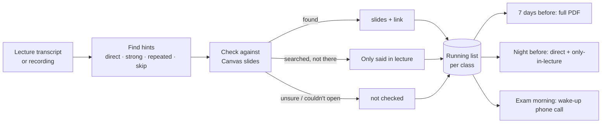

# Front Row 

[](https://github.com/Levvvinnn/front-row-repo/actions/workflows/ci.yml)


A Cubbie Skill for the Cubbie Hackathon (Track 1).

Your professor tells you what's on the exam. You just weren't listening.

For your own studying, send Cubbie the transcript or recording of a lecture. Front Row catches every time your
professor says "this will be on the exam", "know this" or "people always get this wrong", matches each hint to
your Canvas slides, flags what was only said in lecture (and what the prof said is NOT on the exam), and sends
you the full list a week before the exam.

## Install

Text this link to Cubbie:

https://github.com/Levvvinnn/front-row-repo/tree/main/front-row

## How to use it

1. Record the lecture with Voice Memos, phone on the desk (it keeps recording with the screen off). Check your
   syllabus allows recording, and keep recordings for your own studying.
2. After class, open the memo, copy its transcript and send it to Cubbie. This is the fastest way.
   You can also share the audio file itself.
3. Get that lecture's hints. A week before the exam, get the whole list as a PDF.
4. On exam morning, Cubbie can call you and read your top hints out loud (only if you say yes).
5. Say "export" anytime to get your notes as a Markdown file you can drop into any AI model and get quizzed.

```text
BIO 181 today: 3 hints

Direct: Krebs cycle products, she said "this WILL be on the midterm" (min 34)
Strong: ATP yield per glucose, "people always get this wrong"
Repeated: Electron transport chain, came back to it 4 times

The fermentation one isn't in the slides. Only said in lecture.
```

## How it works



**Only said in lecture** is the label that matters most, because classmates who only read the slides miss those
hints. So it has to be earned: it's given only after the slides were actually searched, and it's dropped for a
whole lecture when too many matches are unclear. A missing flag is fine. A wrong one ruins trust in all of them.

## What it uses

Cubbie's built-in abilities: transcribing voice notes and videos, Canvas (if connected), memory, scheduled
check-ins and documents. No keys and no sign-ins.

A small helper script, [`front-row/scripts/frontrow.py`](front-row/scripts/frontrow.py), makes Cubbie sharper and
more consistent. Cubbie runs it in your private sandbox. It never touches the network or Canvas itself:

| Command | What it does |
| --- | --- |
| `scan` | Finds candidate hint moments in a transcript, with minutes in, and the concepts the professor kept repeating |
| `match` | Checks each hint against the downloaded slide decks and pages (PDF, HTML, text) and gives it a status |
| `save` / `list` | Keeps each class's running list on disk, merging a concept mentioned across several lectures |
| `pdf` | Draws the one-page "Front Row: BIO 181 Midterm" sheet, with self-check questions |
| `call` | Writes the 30-second script Cubbie reads on the exam-morning wake-up call |
| `export` | Writes a Markdown file of your hints (and optionally the transcript) to save or paste into ChatGPT, Claude or Gemini |

Pinned packages in [`front-row/requirements.txt`](front-row/requirements.txt): `reportlab` (the PDF), `pypdf`
(reading slide PDFs) and `rapidfuzz` (matching terms the transcript misspelled). The script still runs without
them, and every step in the Skill works by hand if the script can't run.

## Try it locally

```bash
cd front-row
python3 -m venv .venv && .venv/bin/pip install -r requirements.txt   # Python 3.12, like Cubbie
.venv/bin/python scripts/frontrow.py scan --sample
.venv/bin/python scripts/frontrow.py match --sample
.venv/bin/python scripts/frontrow.py list --sample
.venv/bin/python scripts/frontrow.py pdf --sample --exam Midterm --out sample.pdf
.venv/bin/python scripts/frontrow.py call --sample --exam midterm --time "10 AM"
.venv/bin/python scripts/frontrow.py export --sample --out sample-notes.md
```

`--sample` uses the made-up BIO 181 lecture in [`front-row/assets/`](front-row/assets) and never touches saved hints.

## Repo layout

```text
front-row/                  the Skill (this folder is what Cubbie installs)
  SKILL.md                  instructions Cubbie follows
  requirements.txt          pinned packages for the helper script
  scripts/frontrow.py       scan, match, save, list, pdf
  assets/                   sample transcript, hints and slides for --sample
tests/test_frontrow.py      unit tests (python3 -m unittest discover tests)
.github/workflows/ci.yml    tests on Python 3.12 with and without packages, and a SKILL.md format check
```

## Privacy

Recordings and transcripts stay with you and Cubbie. Saved hints live in your own Cubbie sandbox
(`~/.config/front-row/`). Nothing is sent to us or anyone else. Check each class's syllabus allows recording.
